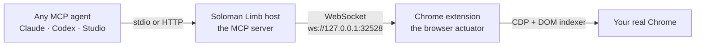

<div align="center">


# Soloman Limb

### MCP for any browser.

Give any MCP agent — Claude Code, Claude Desktop, OpenAI Codex, or your own — a real Chrome browser to drive.

[](LICENSE)
[](#install-the-host)
[](#any-other-mcp-client)
[](#load-the-extension)

[What it is](#what-it-is) · [The Soloman ecosystem](#the-soloman-ecosystem) · [Install](#install) · [Use it with](#use-it-with) · [Tools](#tools) · [Security](#security)

</div>

---

## What it is

Soloman Limb turns a normal Chrome browser into a tool any MCP agent can call. Click, type, scroll, read the page, run JavaScript, and replay saved step-by-step "recipes" — all through your everyday, logged-in browser, not a headless copy.



It ships as two pieces, one package:

| Piece | What it does | Where |
|---|---|---|
| **`octolimb` host** | The MCP server. Speaks MCP to your agent and relays tool calls to the browser. | `src/` → builds to `dist/` |
| **Chrome extension** | The browser actuator. Performs tool calls in Chrome (CDP input events + nanobrowser's DOM indexer). | `extension/` |

> **Why two processes?** A Chrome extension can't listen on a socket or serve stdio — that's a browser security boundary. So the MCP server is a separate host process, and the extension connects *out* to it.

---

## The Soloman ecosystem

Soloman Limb is one arm of the Soloman ecosystem, all on the same account:

| Repo | What it is | How Soloman Limb fits |
|---|---|---|
| 🧠 [**Soloman Studio**](https://github.com/kaleemibnanwar/Soloman-Studio) | Local-first AI workspace — research, docs, data, media, automation, MCP, and development | The **brain**. Studio ships Soloman Limb's bridge in-process, so its agent gets a real browser with one toggle. Soloman Limb is also a standard MCP server, so it plugs straight into Studio's Connections catalog. |
| ✂️ [**Soloman Editor**](https://github.com/kaleemibnanwar/SolomanEditor) | Self-driving, non-destructive desktop video editor | The **cut arm**. Soloman Limb browses and gathers clips, images, and audio from the web; Soloman Editor assembles them on the timeline. |
| ⚡ [**Soloman Manager**](https://github.com/kaleemibnanwar/Soloman-Manager) | Control center & package manager for MCP servers | The **tool shed**. Install, isolate, and supervise MCP servers — including Soloman Limb itself — and export 1-click client configs. |
| 🌐 **Soloman Limb** | MCP for any browser | The **browser arm** — drives any website for any agent. |

**The workflow:** Soloman Studio is the hub. Its agent calls Soloman Limb to go out and *do things in the browser* — fetch a stock clip, pull a reference, fill a form, post an update — and feeds the results back into the project, or into Soloman Editor for editing. Soloman Limb is how the workspace reaches beyond your machine into the open web.

> **Naming note:** the npm package and CLI command are `octolimb`, and the Chrome extension identifies itself as "OctoLimb Bridge" — those technical names are unchanged; Soloman Limb is the product.

---

## Install

### Load the extension

1. Open `chrome://extensions`.
2. Enable **Developer mode** (top-right toggle).
3. Click **Load unpacked** and select the `extension/` folder.

The extension dials out to `ws://127.0.0.1:32528` and reconnects automatically whenever the host comes up.

### Install the host

```bash
npm install -g octolimb      # from npm, or:
# git clone https://github.com/kaleemibnanwar/solomanlimb.git && cd solomanlimb && npm install && npm run build && npm link
```

Confirm it's on your path:

```bash
octolimb --help
```

---

## Use it with

The host runs as a **stdio** server (default — the most universal) or a **Streamable HTTP** server. Both always start the WebSocket relay on `:32528` for the extension.

### Soloman Studio

Soloman Studio already ships an in-process Soloman Limb bridge — **no standalone host needed.** Load the extension, then enable **Settings → "Enable OctoLimb MCP Bridge"**. Studio's agent can then drive a browser for tasks like "post this on Reddit" or "pull the latest pricing from that page."

> **Don't run the standalone host at the same time** — Studio's bridge and this host both bind `:32527`/`:32528`. Pick one. (To run both, start the host with `--http-port 32529 --ws-port 32530`.)

### Claude Code

```bash
claude mcp add octolimb -- octolimb
```

Or via `.mcp.json`:

```json
{
  "mcpServers": {
    "octolimb": { "command": "octolimb", "args": [] }
  }
}
```

### Claude Desktop

**Settings → Developer → Edit Config**, then add to `claude_desktop_config.json`:

```json
{
  "mcpServers": {
    "octolimb": { "command": "octolimb", "args": [] }
  }
}
```

Restart Claude Desktop. (HTTP is also possible — see below.)

### Codex

Add to `~/.codex/config.toml`:

```toml
[mcp_servers.octolimb]
command = "octolimb"
args = []
```

### Any other MCP client

- **stdio** (most common): configure the client to spawn `octolimb` as a command.
- **Streamable HTTP**: run `octolimb --http`, then point the client at `http://127.0.0.1:32527/mcp`.

```bash
octolimb --http                                   # HTTP MCP on :32527 + WS relay on :32528
octolimb --http-port 32529 --ws-port 32530        # override ports
```

---

## Tools

The host exposes **24 tools**:

| Category | Tools |
|---|---|
| 🧭 Navigation | `go_to_url`, `go_back`, `open_tab`, `close_tab`, `switch_tab`, `search_google` |
| 📖 Reading | `read_page` (URL/title + indexed elements), `execute_js`, `get_dropdown_options` |
| 🖱️ Interaction | `click_element`, `input_text`, `select_dropdown_option`, `send_keys`, `wait` |
| 📜 Scrolling | `scroll_to_percent`, `scroll_to_top`, `scroll_to_bottom`, `previous_page`, `next_page`, `scroll_to_text` |
| 🔁 Recipes | `find_recipe`, `run_recipe`, `done` (auto-saves a task on success), `cache_content` |

See [`extension/README.md`](extension/README.md) for how the extension implements these (nanobrowser's DOM indexer + CDP input dispatch).

### Saved recipes

`done`, `find_recipe`, and `run_recipe` give the agent a lightweight memory: a successfully completed task is saved and can be replayed later on the same domain in one `run_recipe` call instead of step-by-step. Recipes live as JSON at `~/.octolimb/recipes.json` (override the directory with `OCTOLIMB_HOME`).

---

## Security

- The host binds to **`127.0.0.1` only** — never a network interface.
- The WebSocket relay accepts only `chrome-extension://` origins, so other local processes can't impersonate the browser.
- Driving Chrome shows its unavoidable **"OctoLimb Bridge is debugging this browser"** banner on attached tabs.
- `execute_js` runs arbitrary JavaScript in the page — grant the extension only to tasks you actually want automated.

---

## License

Apache-2.0 — see [LICENSE](LICENSE). The DOM-indexing script (`extension/buildDomTree.js`) is copied from nanobrowser and carries its own Apache-2.0 license files in `extension/`.
